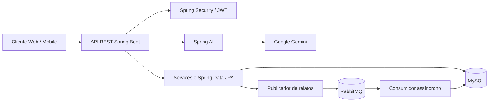
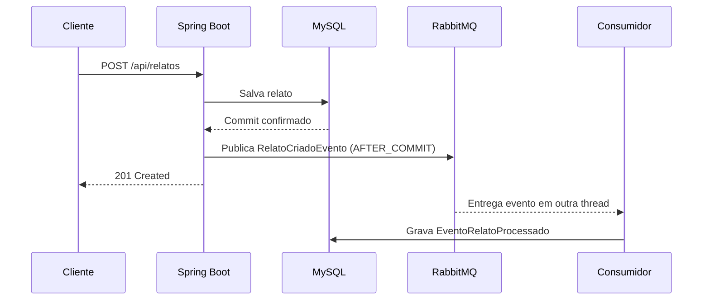

AcessoLivre ♿
Global Solution FIAP — 2º semestre de 2026 | CitizenTech

Backend Java — Java Advanced
Plataforma colaborativa de informações sobre acessibilidade em locais e equipamentos. O AcessoLivre reúne relatos de cidadãos e avisos operacionais e utiliza IA para produzir resumos claros, sem apresentar registros como monitoramento em tempo real.

1. Problema e solução
Pessoas que dependem de elevadores, rampas, plataformas elevatórias e outros recursos de acessibilidade podem encontrar problemas no deslocamento quando não possuem informações suficientes sobre a condição desses equipamentos.

O AcessoLivre permite cadastrar locais e seus recursos, receber relatos de cidadãos, registrar avisos operacionais de responsáveis e consultar um resumo produzido com IA generativa a partir das informações disponíveis no banco.

Importante: o sistema não verifica equipamentos fisicamente nem monitora seu funcionamento em tempo real. Um relato ou uma previsão de retorno não confirma, por si só, a situação atual de um recurso.
2. Tecnologias
Área	Tecnologia
Linguagem	Java 17
Backend	Spring Boot 4.1.2, Spring MVC
Persistência	Spring Data JPA, Hibernate, MySQL 8.0
Segurança	Spring Security, JWT HS256, BCrypt, perfis de acesso
Validação	Bean Validation e @RestControllerAdvice
Inteligência artificial	Spring AI 2.0.2 + Google Gemini
Mensageria	RabbitMQ 4, Spring AMQP
Documentação da API	Swagger/OpenAPI (Springdoc)
Testes	JUnit 5, Mockito, Gradle
Desenvolvimento	Gradle Wrapper, Docker Compose, Azure DevOps Repos/Boards

3. Arquitetura e modelagem
A aplicação utiliza uma arquitetura em camadas:
- Controllers: endpoints HTTP e entrada dos DTOs.
- Services: regras de negócio, autorização e transações.
- Repositories: persistência com Spring Data JPA.
- Entities: domínio e relacionamentos.
- Security: login, emissão e validação de JWT.
- Evento: publicação/consumo de mensagens RabbitMQ.
- IA: geração de resumo a partir dos dados de relatos e avisos.

Entidades principais
Entidade	Responsabilidade	Relacionamentos principais
Usuario	Identidade, e-mail, senha protegida e perfil	Autor de relatos/avisos e responsável por locais
Local	Estabelecimento ou ponto de interesse	Possui recursos; pode ter responsável
RecursoAcesso	Equipamento ou infraestrutura de acessibilidade	Pertence a um local
Relato	Observação de cidadão sobre um recurso	Autor (Usuario) e RecursoAcesso
AvisoOperacional	Informação operacional publicada sobre um recurso	Autor (Usuario) e RecursoAcesso

Uma entidade técnica adicional, EventoRelatoProcessado, registra o processamento de eventos recebidos via RabbitMQ.
4. Como executar localmente
Pré-requisitos
- JDK 17;
- Docker Desktop com Docker Compose;
- Git;
- Acesso à internet para baixar as dependências do Gradle;
- Opcional: IntelliJ IDEA, VS Code, Insomnia ou Postman;
- Para a funcionalidade de IA: chave de API válida do Google Gemini.
4.1. Obter o projeto
git clone <URL_DO_REPOSITORIO_PUBLICO_OU_AUTORIZADO>
cd AcessoLivre
Substitua o endereço acima pelo URL definitivo do repositório. Insira o link adequado ao canal de entrega, conforme exigência da disciplina correspondente; não exponha repositórios privados indevidamente.

4.2. Configurar o .env do Docker
Crie na raiz do projeto, ao lado de compose.yaml, o arquivo .env:
MYSQL_ROOT_PASSWORD=SUBSTITUA_POR_SENHA_FORTE_LOCAL
MYSQL_PASSWORD=SUBSTITUA_POR_OUTRA_SENHA_FORTE_LOCAL
RABBITMQ_USER=acessolivre
RABBITMQ_PASSWORD=SUBSTITUA_POR_SENHA_FORTE_LOCAL
Use valores reais e particulares no seu computador. Nunca versionar ou compartilhar o .env, chaves de IA, tokens ou senhas. A senha definida para o MySQL na inicialização do volume deve ser a mesma fornecida à API.
4.3. Iniciar MySQL e RabbitMQ
docker compose up -d
docker compose ps
Serviços locais definidos no compose.yaml:
Serviço	Endereço ou porta
MySQL	localhost:3307 (porta interna 3306)
RabbitMQ AMQP	localhost:5672
RabbitMQ Management	http://localhost:15672

O painel do RabbitMQ utiliza RABBITMQ_USER e RABBITMQ_PASSWORD do ambiente local. Os dados do MySQL e do RabbitMQ são preservados em volumes Docker. Evite docker compose down -v se desejar manter esses dados.
4.4. Preparar as variáveis da aplicação
Variável	Uso
MYSQL_PASSWORD	Senha do usuário acessolivre_user no MySQL
RABBITMQ_USER	Usuário do broker RabbitMQ
RABBITMQ_PASSWORD	Senha do RabbitMQ
JWT_SECRET	Chave aleatória em Base64, com pelo menos 32 bytes após decodificação
AI_CHAT_PROVIDER	google-genai para habilitar Gemini; none para desabilitar a geração com modelo
GEMINI_API_KEY	Chave privada da API do Google Gemini
GEMINI_MODEL	Modelo Gemini configurável; verificar disponibilidade na sua conta
RABBITMQ_HOST	Opcional, padrão localhost
RABBITMQ_PORT	Opcional, padrão 5672

Gerar JWT_SECRET no PowerShell (Windows):
$b = New-Object byte[] 48
$rng = [System.Security.Cryptography.RandomNumberGenerator]::Create()
$rng.GetBytes($b)
$rng.Dispose()
[Convert]::ToBase64String($b)
Guarde o resultado em local privado; o exemplo acima não é uma chave reutilizável. Alterar a chave invalida os JWT emitidos anteriormente.

No IntelliJ, use Run → Edit Configurations → Environment variables na configuração de execução da aplicação. As variáveis definidas nessa configuração não são automaticamente transferidas para um Git Bash ou PowerShell separado.

Se preferir iniciar pelo Git Bash, exporte as mesmas variáveis nessa sessão antes do bootRun; não cole senhas em comandos públicos ou arquivos versionados.
4.5. Iniciar a API
No Git Bash do Windows:
./gradlew.bat bootRun
Em Linux/macOS:
./gradlew bootRun
A API local escuta em http://localhost:8080.

Swagger UI: http://localhost:8080/swagger-ui/index.html

OpenAPI JSON: http://localhost:8080/v3/api-docs
O banco local está configurado para jdbc:mysql://localhost:3307/acessolivre_db, com spring.jpa.hibernate.ddl-auto=update. Essa é uma configuração de desenvolvimento; a nuvem precisa de configuração própria de conexão, credenciais e criação controlada do esquema.

5. Autenticação e permissões
Existem três perfis: CIDADAO, RESPONSAVEL e ADMIN.
- O cadastro público cria contas com perfil CIDADAO; o usuário não escolhe o próprio perfil.
- O login retorna um JWT com validade de 60 minutos. A identificação (sub) utiliza o ID imutável do usuário, e não seu e-mail.
- O Spring consulta o perfil atual no banco para autorizar operações protegidas.
- Administradores gerenciam locais e podem atribuir um responsável a um local.
- Responsáveis gerenciam avisos operacionais conforme o vínculo com seus locais.
- Cidadãos podem registrar relatos; a atualização/exclusão respeita autoria ou privilégios de administrador.
Envie o token em operações protegidas:
Authorization: Bearer <SEU_TOKEN_JWT>
Não há endpoint público para promover usuários a ADMIN. O administrador inicial deve ser provisionado de maneira controlada no ambiente de teste, antes de testar funções administrativas. Não utilize alterações manuais de perfil como procedimento público ou de produção.
6. Endpoints principais
As rotas usam prefixo /api.
Método	Rota	Finalidade
POST	/api/usuarios/cadastro	Criar conta cidadã
POST	/api/auth/login	Autenticar e obter JWT
GET	/api/usuarios	Listar usuários (ADMIN)
GET/PUT/DELETE	/api/usuarios/{id}	Consultar, atualizar ou excluir conforme autorização
GET/POST	/api/locais	Listar / criar locais
GET/PUT/DELETE	/api/locais/{id}	Consultar / atualizar / excluir local
PUT	/api/locais/{id}/responsavel	Atribuir responsável (ADMIN)
GET/POST	/api/recursos	Listar / criar recursos de acessibilidade
GET/PUT/DELETE	/api/recursos/{id}	Consultar / atualizar / excluir recurso
GET/POST	/api/relatos	Listar / registrar relatos
GET/PUT/DELETE	/api/relatos/{id}	Consultar / atualizar / excluir relato
GET/POST	/api/avisos-operacionais	Listar / registrar avisos
GET/PUT/DELETE	/api/avisos-operacionais/{id}	Consultar / atualizar / excluir aviso
POST	/api/ia/recursos/{recursoId}/resumo	Resumo contextual com Spring AI

As listagens usam paginação do Spring Data (page, size, sort). Algumas aceitam filtros opcionais: localId em /api/recursos e recursoId em /api/relatos ou /api/avisos-operacionais.

Observação: as operações GET de locais, recursos, relatos e avisos são públicas na configuração atual. Demais permissões são aplicadas pela configuração de segurança e pelas regras de serviço. Para a lista detalhada de esquemas e respostas, consulte o Swagger.
Exemplos de requisições
Cadastro:
POST /api/usuarios/cadastro
Content-Type: application/json
{
  "nome": "Pessoa Exemplo",
  "email": "pessoa.exemplo@example.com",
  "senha": "SenhaTeste123!"
}
Login:
POST /api/auth/login
Content-Type: application/json
{
  "email": "pessoa.exemplo@example.com",
  "senha": "SenhaTeste123!"
}
Criar local (ADMIN):
POST /api/locais
Authorization: Bearer <TOKEN_ADMIN>
Content-Type: application/json
{
  "nome": "Estação Exemplo",
  "tipo": "Estação de transporte",
  "endereco": "Endereço fictício para testes"
}
Criar recurso (ADMIN):
POST /api/recursos
Authorization: Bearer <TOKEN_ADMIN>
Content-Type: application/json
{
  "nome": "Elevador principal",
  "tipo": "ELEVADOR",
  "localizacaoInterna": "Entrada principal",
  "localId": 1
}
Criar relato (usuário autenticado):
POST /api/relatos
Authorization: Bearer <TOKEN_CIDADAO>
Content-Type: application/json
{
  "recursoId": 1,
  "descricao": "Elevador apresentou falha durante a visita.",
  "condicao": "COM_PROBLEMA",
  "observadoEm": "2026-11-13T09:30:00"
}
Atribuir responsável (ADMIN):
PUT /api/locais/1/responsavel
Authorization: Bearer <TOKEN_ADMIN>
Content-Type: application/json
{
  "responsavelId": 2
}
O recurso e os IDs acima são exemplos, não dados garantidos em uma instalação nova. Utilize os IDs retornados pelos cadastros e datas válidas para seus testes.

Resumo por IA:
POST /api/ia/recursos/1/resumo
Authorization: Bearer <TOKEN_VALIDO>
Essa requisição não requer corpo JSON.
7. Spring AI + Gemini
O endpoint de resumo consulta um recurso e recupera até 10 relatos e até 10 avisos operacionais relacionados a ele. O ResumoIaService organiza as informações e envia o contexto a um modelo Gemini por meio de ChatClient do Spring AI.

A instrução enviada ao modelo solicita um resumo em português, diferencia relatos de avisos, considera datas e conflitos de informação e proíbe inventar confirmações, diagnósticos ou prazos. Descrições escritas pelos usuários são tratadas como dados, nunca como instruções ao modelo.

O resultado contém o ID, nome do recurso, local, quantidade de registros analisados, resumo e horário de geração. Se não houver registros, a aplicação informa que não é possível confirmar a condição do recurso. Se o serviço de IA estiver indisponível, a API pode retornar erro de serviço, sem fabricar um resumo.

Verificação realizada durante o desenvolvimento: o endpoint retornou HTTP 200 OK em teste manual com uma chave Gemini válida. Isso não substitui testes de integração em todos os ambientes.
8. Arquitetura distribuída — opção A: RabbitMQ
Para o requisito de arquitetura distribuída da disciplina Java, foi escolhida a opção A: mensageria assíncrona com RabbitMQ.

Configuração usada no código:
- Exchange: acessolivre.eventos
- Fila: acessolivre.relatos.criados
- Routing key: relato.criado
- Evento: RelatoCriadoEvento (relatoId, recursoId, condicao)
O consumidor registra o evento processado no MySQL e sinaliza condições que merecem atenção operacional. A gravação em tabela de auditoria permite verificar o consumo.

Verificação realizada durante o desenvolvimento: logs de publicação e consumo e registro de auditoria no MySQL foram observados em um teste manual de ponta a ponta.

Limitação conhecida: se o envio da mensagem falhar após o commit do relato, o código registra o erro, mas não mantém uma fila persistente de reenvio (outbox). O caminho de sucesso foi testado; recuperação de falhas ainda não foi demonstrada.
9. Testes
O projeto possui 14 testes automatizados, escritos com JUnit 5 e Mockito, cobrindo regras de autenticação, JWT por ID, permissões, atribuição de responsáveis e eventos de relatos.

Execute:

Windows (Git Bash):
./gradlew.bat clean test
Linux/macOS:
./gradlew clean test
Relatório local gerado em:
build/reports/tests/test/index.html
Na execução de 13/11/2026, após integração das alterações à branch main, os 14 testes passaram, com BUILD SUCCESSFUL.

Esses são principalmente testes unitários com simulações (mocks): comprovam regras específicas, mas não substituem ensaios completos de rede, banco, RabbitMQ e Gemini nem comprovam a implantação Azure. Testes HTTP manuais também foram realizados durante o desenvolvimento.
10. Usuários de teste e preparação de dados
O repositório não garante contas pré-cadastradas em uma instalação nova: o MySQL pode iniciar vazio. Utilize POST /api/usuarios/cadastro para criar uma conta fictícia de perfil CIDADAO, como a pessoa do exemplo acima.

Para testar as rotas de administrador e atribuição de responsáveis, o ambiente de demonstração deve possuir uma conta ADMIN provisionada de forma controlada pelo responsável do banco de testes. Não exponha senha de administrador nem publique dados reais no repositório.

Antes da entrega, preencher aqui os usuários fictícios efetivamente preparados para demonstração (identificador e perfil; senhas compartilhadas apenas por canal privado, se necessário):
Usuário de demonstração	Perfil	Situação
pessoa.exemplo@example.com	CIDADAO	Exemplo de cadastro; não pré-instalado
[definir conta de demonstração]	ADMIN	Provisionamento de teste pendente de documentar
[definir conta de demonstração]	RESPONSAVEL	Atribuído por um ADMIN durante a demonstração

11. Situação da nuvem, DevOps e CI/CD (atualizado em 18/11/2026)
11.1. Infraestrutura implantada na Azure
A infraestrutura do AcessoLivre está provisionada na assinatura institucional utilizada nas atividades, na região southafricanorth:
Recurso	Identificador / configuração	Situação observada em 18/11/2026
Resource Group	rg-acessolivre-rm554882	Existente
Azure Container Registry	acracessolivrem554882	Imagem da API publicada
Azure Container Instances	aci-acessolivre-rm554882	Grupo em execução (Running)
Contêiner mysql	mysql:8.0	Running, sem reinicializações no registro consultado
Contêiner rabbitmq	rabbitmq:4-management	Running, sem reinicializações no registro consultado
Contêiner api	acracessolivrem554882.azurecr.io/acessolivre-api:v1	Running, sem reinicializações no registro consultado

No JSON consultado do ACI, foi identificado o IP público 4.253.123.110 e a porta externa 8080. Endereço observado, ainda não validado por teste HTTP nesta revisão: http://4.253.123.110:8080.

A API usa as configurações do ambiente Azure para conectar-se ao MySQL e ao RabbitMQ dentro do mesmo grupo de contêineres. As credenciais, o JWT e a chave de IA são fornecidos por variáveis protegidas, não devem aparecer em arquivos versionados ou evidências públicas.

Limitação crítica de persistência: não foram identificados volumes ou volumeMounts na configuração consultada do ACI. Portanto, o MySQL não possui armazenamento externo persistente demonstrado; recriar ou atualizar o grupo de contêineres pode causar perda de dados. Não reiniciar, excluir ou recriar o ACI sem planejar backup e persistência. O ambiente local, por outro lado, usa volumes do Docker Compose.

Estado comprovado: três processos de contêiner em Running. Isso não comprova, isoladamente, que todos os endpoints HTTP, a integração com Gemini, a mensageria e o CRUD em nuvem estão funcionando. Esses testes devem ser feitos e registrados separadamente.
11.2. Organização do repositório e scripts
Estrutura conferida no Azure Repos (main):
AcessoLivre/
├── src/
├── docs/
│   ├── arquitetura-acessolivre.*
│   └── infraestrutura.md
├── scripts/
│   ├── 01-criar-grupo.sh
│   ├── 02-criar-acr.sh
│   ├── 03-configurar-identidades.sh
│   ├── 04-publicar-imagem.sh
│   ├── 05-implantar-aci.sh
│   ├── 06-verificar-nuvem.sh
│   └── script-bd.sql
├── dockerfiles/
├── azure-pipeline.yml
├── azure-pipelines.yml   # cópia antiga; remover somente após validar a nova configuração
├── Dockerfile
├── compose.yaml
├── build.gradle
└── README.md
O script-bd.sql contém comandos DDL para tabelas como usuarios, locais, recursos_acesso, relatos, avisos_operacionais e eventos_relato_processados, com chaves primárias e relacionamentos. A presença do DDL no repositório não garante que ele foi executado no banco Azure; a estrutura real precisa ser conferida via consultas SQL.

Os scripts são mantidos como referência de provisionamento e auditoria. O arquivo 05-implantar-aci.sh é destinado à primeira implantação e exige um YAML privado fora do Git. Se o ACI já existir, o script intencionalmente não o atualiza, para evitar perda de dados do MySQL. Não usar esse script como se já fosse um fluxo de atualização automática seguro.
11.3. Azure DevOps — CI (Build)
- Projeto: AcessoLivre, com Azure Repos e Azure Boards.
- Arquivo YAML selecionado na definição da Build: /azure-pipeline.yml (singular, conforme enunciado da GS), na branch main.
- Gatilho YAML: alterações na main (trigger.branches.include: main). O fluxo exigido pela disciplina é usar branch, Pull Request, revisão e merge na main, com políticas configuradas no Azure Repos.
- Branch Policies: registradas como configuradas durante a revisão do projeto; conferir os detalhes na tela antes da gravação.
- Agente: ubuntu-latest; Java 17; Gradle Wrapper executando clean test bootJar.
- Testes: tarefa PublishTestResults@2 com formato JUnit.
- Artefato: acessolivre-jar a partir de build/libs.
- Histórico: há registro de Build bem-sucedida e de 14 testes aprovados em 13/11/2026; também houve execuções com falha posteriores. A troca do caminho para o arquivo singular foi feita em 18/11/2026 e ainda requer validação de uma execução com esse arquivo.
No Azure Repos, validação de PRs deve ser configurada em Branch Policies / Build validation. O bloco pr: dentro do YAML não substitui essa configuração.

11.4. Azure DevOps — Release Classic (CD)
A Release Classic foi salva com as seguintes características:
Item	Configuração observada
Pipeline	New release pipeline (nome ainda não padronizado)
Artifact de origem	_AcessoLivre, da Build AcessoLivre, com JAR publicado como acessolivre-jar
Stage	Producao
Task	Azure CLI versão 3.*
Service Connection	ProfAntonioFigueiredo2Semestre2026, conexão ARM compartilhada com o projeto AcessoLivre dentro da mesma organização
Agente	Azure Pipelines / ubuntu-latest
Script Type / Location	Shell / Inline script
Script configurado	az account show --output table
Condição do Stage	Manual only
Implantação automática	Não implementada e não comprovada

O script atual consulta a assinatura Azure e não realiza deploy. A definição da Release e os prints das configurações são evidências da preparação, não da execução nem de um CD completo. Para atingir o fluxo exigido no enunciado, ainda são necessários publicação de imagem atualizada, implantação segura, gatilhos adequados e demonstração de Build + Release após um merge. A falta de Parallel Jobs disponíveis na organização pode impedir execuções, mesmo com a configuração salva.
11.5. Testes em nuvem e evidências pendentes
Rota pública de leitura sugerida para a primeira verificação (somente GET):
GET http://4.253.123.110:8080/api/locais?page=0&size=5
Essa URL é uma hipótese de acesso baseada no endereço e na porta observados no ACI; não há confirmação de resposta HTTP 200 para ela nesta revisão. Validar também o Swagger, se habilitado nesse ambiente:
http://4.253.123.110:8080/swagger-ui/index.html
http://4.253.123.110:8080/v3/api-docs
Para demonstrar CRUD, usar os exemplos JSON da seção 6 e credenciais fictícias preparadas com segurança. Registrar os IDs retornados pela API. Para comprovar persistência na avaliação de DevOps, executar também SELECT diretamente no banco MySQL em nuvem; um GET da API não substitui a consulta ao banco. Não expor senhas, tokens, chaves nem dados pessoais nos prints ou vídeos.

Checklist de entrega DevOps (estado em 18/11):
- [x] Projeto e código em Azure Repos; pastas de infraestrutura presentes.
- [x] Azure Boards e Branch Policies configurados, conforme acompanhamento da atividade.
- [x] Scripts de provisionamento, Dockerfiles e script-bd.sql encontrados no repositório.
- [x] Infraestrutura ACR/ACI criada; três contêineres em Running.
- [x] Definição de CI com testes e publicação do JAR; sucesso anterior registrado.
- [x] Release Classic com Service Connection e tarefa de consulta configuradas.
- [ ] Validar a CI após a mudança para /azure-pipeline.yml.
- [ ] Demonstrar o HTTP/Swagger, operações CRUD e SELECT diretamente no MySQL da nuvem.
- [ ] Demonstrar Release de deploy automático com segurança, se possível, sem destruir os dados atuais.
- [ ] Confirmar evidências dos testes JUnit na execução escolhida.
- [ ] Gravar vídeo narrado em resolução mínima de 720p, mostrando o fluxo exigido pelo professor.
- [ ] Preparar PDF de DevOps com identificação, link da organização Azure DevOps e link do vídeo publicado.
11.6. Integração Mobile e materiais de entrega
- Integração Mobile: [adicionar link e evidência quando estiver concluída].
- Vídeo pitch Java (até 5 minutos): [adicionar link quando publicado].
- Vídeo de demonstração DevOps: [adicionar link do YouTube quando publicado].
- URL pública do GitHub, se exigida pela disciplina Java: [inserir URL correta após confirmar].
Não considerar um serviço inteiramente validado apenas por estar em execução na Azure.
12. Limitações e melhorias futuras
- Registrar e utilizar a data de atualização dos avisos operacionais nos resumos da IA, além da data original de publicação.
- Testar de ponta a ponta a continuidade do acesso após alteração de e-mail, apesar de os testes unitários já cobrirem a identidade do token por ID.
- Implementar um mecanismo persistente de reenvio de eventos (por exemplo, transactional outbox) e cenários de falha do RabbitMQ.
- Definir um processo seguro de criação do primeiro administrador por ambiente.
- Substituir ddl-auto=update por migrações/esquema controlado na infraestrutura de entrega.
- Validar a API e o banco no ACI com testes HTTP e SQL; concluir a automação do deploy com persistência segura, a integração Mobile e os testes integrados adicionais.
13. Declaração de uso de inteligência artificial
Este projeto utiliza IA de duas formas distintas:
1. Na solução: Google Gemini, integrado via Spring AI, produz resumos contextuais a partir de relatos e avisos operacionais armazenados pelo AcessoLivre.
2. Durante o desenvolvimento: ChatGPT foi utilizado como apoio para planejamento, explicações técnicas, revisão, depuração, elaboração de testes e documentação. O grupo é responsável pela avaliação das sugestões, pela execução dos testes e pela validação do código entregue.
As respostas de IA não devem ser tratadas como verificações físicas da acessibilidade dos locais.
14. Integrantes e entrega
Instituição: FIAP

Global Solution: 2026/2 — CitizenTech

Projeto: AcessoLivre

Turma: 2TDSPG-2026 (confirmar na entrega)
Integrante	RM
Emily Maria de Oliveira Macedo	RM554882

Repositório GitHub (se aplicável à entrega Java): [inserir URL real]

Link do vídeo pitch: [inserir URL quando publicado]

Deploy Azure (IP observado, ainda sem teste HTTP validado nesta revisão): http://4.253.123.110:8080

A entrega de Java também exige o arquivo .txt de identificação dentro do ZIP entregue no Portal do Aluno, conforme o enunciado oficial. Não incluir .env, tokens, chaves, senhas, diretório .git ou artefatos desnecessários na compactação pública.
